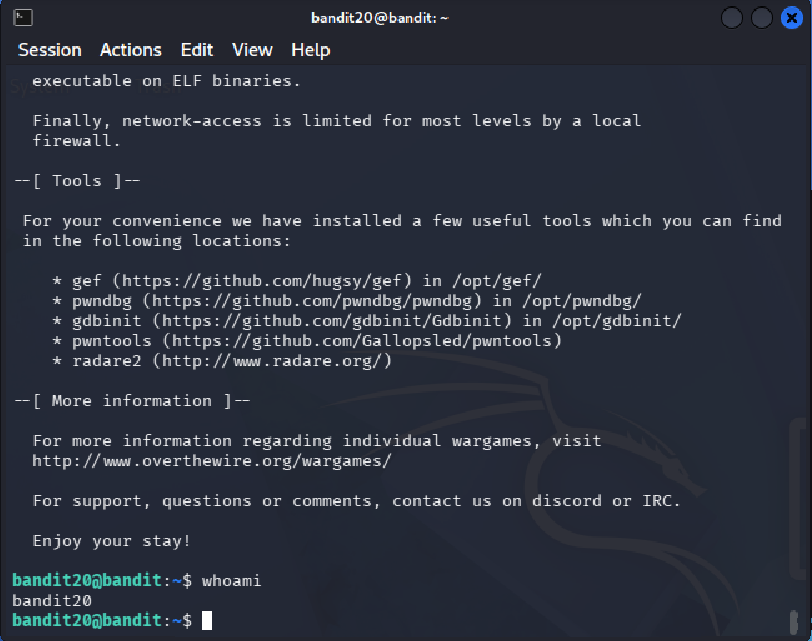

# Part A — TryHackMe and OverTheWire

Completion evidence.

| File | Platform | Room / level |
|---|---|---|
| `evidence/Fundamentals1.png` | TryHackMe | Fundamentals |
| `evidence/Nmap.png` | TryHackMe | Nmap |
| `evidence/OverTheWire-Bandit20.png` | OverTheWire | Bandit: logged in as `bandit20` (`whoami` confirms), i.e. levels 0–19 completed |

